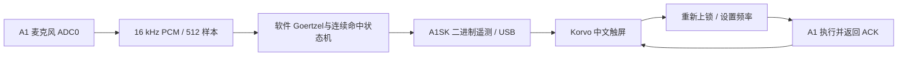

# ESP32-A1 声音钥匙

[English](README.en.md)

用一段特定频率的声音打开屏幕上的锁：**ESP32-A1 EV Board 采音，ESP32-S31-Korvo-1 显示中文触屏界面**。

目标可选 **500 / 1,000 / 2,000 Hz**，连续命中约 **0.5 秒**后解锁。可以播放本仓库的 WAV，直观看到错频拒绝、保持进度、解锁和触屏重新上锁。

> 当前解锁使用 **PCM 软件 Goertzel**。A1 芯片内置 Goertzel 仅作为原始值诊断，仍待标定；界面标注“软件参考 / 硬件待标定”。

## 演示与实测

2026-10-09，原本地演示已在两块实板上完成同步播放与 UART 采集，目标为 1,000 Hz：

| 输入 | 结果 |
|---|---|
| 750 Hz，持续 2 秒 | 保持上锁 |
| 1,000 Hz，持续 200 ms | 解锁计数不增加 |
| 1,000 Hz，持续 2 秒 | 保持值达到 500/500 ms，解锁计数增加一次 |
| 音调停止 | 解锁状态保持，等待触屏重新上锁 |

测试期间 USB 和 PCM 连续工作，没有新增 CRC、帧头、发送错误或序列缺口。详见[实测记录及观察范围](docs/evidence/2026-10-09-acceptance.md)。500 / 2,000 Hz 及硬件 Goertzel 尚未完成声学实测。

本仓库是独立公开导出：构建入口改为外部 SDK 参数，中文字体改为 **SIL OFL 的 Noto Sans SC**。公开导出没有重新编译或烧录验收；以上实测属于原本地演示，不能直接当作公开字体版的验收。

## 硬件连接

| 硬件 | 本次使用 |
|---|---|
| 采音板 | ESP32-A1 EV Board V1.0，板载 ESP32-S31 |
| 显示板 | ESP32-S31-Korvo-1，800×480 LCD 与触摸 |
| 数据连接 | Korvo USB-A Host → A1 USB DEVICE |
| A1 供电 | 独立 POWER 接口接电，S5=ON |
| 调试口 | Korvo UART Type-C → 电脑 |
| 麦克风 | A1 板上麦克风，本例读取 ADC0 单声道 |

已验证板卡的 J48 振荡器使能跳帽和四颗麦克风偏置跳帽完整，I²C / I²S / A1_EN 跳帽沿用板级配置。不同板卡版本须对照其原理图与实物。本例不挂载、不写 microSD。

A1 USB DEVICE 和独立 POWER 对应的供电路径需要分别确认。需要完整重启 A1 时，断开两个接口的供电，等 3 秒，再接回 POWER 和 USB DEVICE。

## 构建要求

1. 支持 `esp32s31` 的 ESP-IDF preview 及对应工具链。本地实测使用 ESP-IDF 6.2 preview，提交 `c712a0dde385d659a1470a136251980d31a70bc1`，GCC 16。
2. 官方提供的 **ESP32-A1 SDK v0.5.0**，目录中应有 `src/`、`include/`、`private_inc/` 和 `examples/esp_friends_boards/`。
3. 匹配的 `esp_codec_dev`：实测使用 2.0.0-beta4 系列；组件注册表可解析时自动下载，也可设置本地源码路径。

**A1 SDK 和 S31 工具链需要自行取得。**预先提供的官方 SDK、PDF、参考设计和完整工具链未包含在本仓库。仅下载本仓库还不足以构建 A1 固件。

其余 ESP-IDF 组件依赖写在两个工程的 `main/idf_component.yml`，首次构建由组件管理器解析。

### Windows PowerShell

先运行所用 ESP-IDF 环境的 `export.ps1`，确认 `IDF_PATH` 和 `python` 可用：

```powershell
git clone https://github.com/HwzLoveDz/esp32-a1-sound-key.git
cd esp32-a1-sound-key

$env:ESP32_A1_SDK_ROOT = 'D:\SDK\esp32_a1_v0.5'
# 可选：使用与 SDK 匹配的本地 esp_codec_dev
# $env:ESP_CODEC_DEV_ROOT = 'D:\SDK\esp_codec_dev'

.\build.ps1 -Target Both
# 或 -Target A1 / -Target Korvo
```

Linux / macOS 可在已导出的 ESP-IDF 环境中，设置相同环境变量，进入对应项目运行 `idf.py --preview -DIDF_TARGET=esp32s31 build`。

应用名：

| 项目 | 产物 |
|---|---|
| `a1_device` | `build/a1_sound_key_device.bin` |
| `korvo_host` | `build/a1_sound_key_host.bin` |

分区 CSV 沿用本次已验证的 16 MB Flash 板卡：A1 factory `0x10000 / 0x300000`；Korvo factory `0x10000 / 0x800000`，保留后面的已有素材区。再次烧录前读取实际目标的分区表，按该目标布局写入；本仓库不执行自动刷写。旧板仅更新应用时，可在核对地址后使用 `esptool write-flash 0x10000 <app.bin>`。

## 怎么拍演示

1. 两板运行固件，屏幕选 **1,000 Hz**，点“重新上锁”。
2. 手机或电脑播放 [750 Hz 错频](tones/wrong-750Hz.wav)：音量变化，锁保持关闭。
3. 播放 [200 ms 短音](tones/short-1000Hz-200ms.wav)：时长不足，解锁次数不增加。
4. 播放 [1,000 Hz 钥匙](tones/key-1000Hz.wav)：进度完成，屏幕解锁。
5. 停止播放，展示解锁保持，再点“重新上锁”。

其余音调：[500 Hz](tones/key-500Hz.wav)、[2,000 Hz](tones/key-2000Hz.wav)、[静音](tones/silence.wav)。WAV 为 16 kHz、16 bit、单声道，文件长 3 秒，正常钥匙含 2 秒纯音和渐入渐出。它们是生成的演示素材。

## 采集验证记录

同步验证工具在同一 Windows Python 进程内播放 WAV 并读取 Korvo UART，运行 22 秒后停止播放并关闭串口：

```powershell
python -m pip install -r tools/requirements.txt
python tools/acoustic_probe.py --port COM25 --output captures/session-001
```

`COM25` 只是示例，替换为自己的 Korvo UART。运行前重新上锁并选 1,000 Hz；保持电脑扬声器能够发声，A1 麦克风靠近扬声器。工具要求实时遥测有效，并记录播放时刻、计数变化、链路连续性与每阶段判据。`captures/` 默认不提交 Git。

UART 每秒一帧：200 ms 短音可能落在快照之间，该项仅证明受控播放后计数未增加；该记录也不能精确测量物理解锁延迟。

## 实现



- 去除每块 DC 后计算 RMS 与目标单频能量占比。
- 软件强度范围 0–1000；进入阈值 700，保持阈值 550，RMS 下限 180 PCM counts。
- 每块 512 样本约 32 ms，默认 16 个有效块完成首次解锁，约 512 ms。
- 错频、静音、采样空隙或明显削波清除未完成的保持进度。
- 解锁锁存至重新上锁或切换目标；次数保存在 RAM。
- USB 命令收到执行 ACK 后生效，待确认期间隐藏旧解锁；断连 / 失联清除显示并进行重新同步。
- 硬件 Goertzel 诊断有时间预算，失败后停用诊断。长按频率区可查看诊断卡；硬件原始值不参与解锁。

## 目录与许可

```text
a1_device/       采音、检测、USB 遥测
korvo_host/      USB Host、LVGL 界面、触摸命令
common/         两板协议
tones/          演示音调
tools/          字体/音调生成与同步验证
fonts/          Noto Sans SC 与 OFL
docs/evidence/  去除本机身份的验收摘要
```

原创程序、工具与音调采用 [Apache-2.0](LICENSE)。Espressif 板级生成代码和字体分别保留各自许可，详见 [THIRD_PARTY_NOTICES.md](THIRD_PARTY_NOTICES.md)。

项目由 [HwzLoveDz](https://github.com/HwzLoveDz) 发布。
